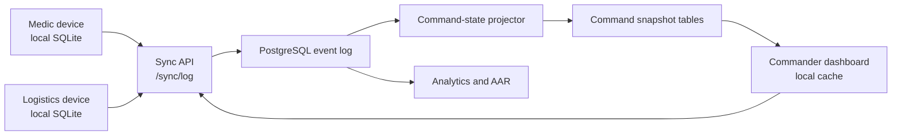

# Architecture

C5 Sentinel-SAR is designed as a local-first command-and-control system for medical SAR workflows. The repo currently contains a prototype and design assets, but the intended architecture is explicit so future implementation work has a stable direction.

## System Shape



## Runtime Boundaries

| Boundary | Responsibility | Current repo artifact |
| --- | --- | --- |
| Field app | Capture patients, vitals, treatments, handovers, and local alerts | `index.html` |
| Command dashboard | Show incident state, stale data, high-risk alerts, and site progress | `index.html`, `assets/mockups/` |
| Domain rules | Triage, vitals timers, tourniquet timers, and alert classification | `src/domain/rules.js` |
| Sync API | Accept and return ordered event batches | `docs/API_SURFACE_v1.2.md` |
| Event store | Preserve clinical and operational history | `database/001_postgresql_schema_v1.2.sql` |
| Projectors | Convert raw events into command-ready state | SQL views and future workers |
| Analytics | Compute KPIs and generate AAR material | `analytics/c5_sentinel_sar_analytics_v1_1/` |

## Event Model

The intended source of truth is an append-only event log.

- Devices create local events first.
- Events receive local IDs and timestamps before sync.
- The server accepts valid events in a batch even if other events fail.
- Invalid or dependency-blocked events are written to an ingestion error table.
- Clinical history is not silently rewritten.
- Command views read projected state.

## Handover and Command State

MIST handover is represented by `PATIENT_HANDED_OVER`. The event is local-first, idempotent by `device_id + local_event_id`, and may carry secure QR token metadata for cross-agency pickup. The projection sets the patient to `handed_over`, clears `needs_full_assessment`, and resolves patient-specific watchdog alerts such as vitals overdue or tourniquet reassessment overdue.

The Chamal/command dashboard should read `incident_command_state` through backend APIs. The database also exposes `vw_command_incident_throughput_funnel` for operational throughput and AAR analytics without forcing dashboard requests to scan the raw event log.

Black/expectant triage is represented by `PATIENT_TRIAGED_EXPECTANT`. It is a fast-exit event: the client bypasses remaining forms, and the projection sets `current_triage = black`, `current_status = deceased`, and `needs_full_assessment = false`, subject to the same role-authority tie-break as any other triage change (`database/041`, `docs/CONFLICT_RESOLUTION_DECISION.md`).

## Domain Rules

The first extracted domain module is `src/domain/rules.js`. It is deliberately browser-compatible and CommonJS-compatible so the standalone prototype can load it directly while Node can test it without a build step. Because there is no build step, the browser doesn't load this file directly - `index.html` and `demo/rescue-app.html` each carry an inlined copy of the same `buildDomainRules()` factory body. `scripts/check_repo.py` enforces that the inlined copies stay byte-identical (modulo whitespace/formatting) to `src/domain/rules.js`, so a change made in only one place fails CI instead of silently diverging - this is how the SABCDE airway-check drift and the untested `suggestedSweepColor` sweep classifier both happened in the first place.

Covered today:

- vitals reassessment eligibility
- vitals warning/overdue timers
- tourniquet warning/critical timers
- MSTART fast-sweep classification (`suggestedSweepColor` - walking/breathing/perfusion/AVPU/trapped fields, used during the initial scan)
- MSTART full-vitals triage calculation and suggestion reasons (`computeMstartTriage` / `suggestMstartTriage`, used for re-triage once full vitals are recorded - a distinct function from the sweep classifier above, not a duplicate of it)
- deterioration detection
- routine vs. critical alert classification

When changing anything in this file, edit `src/domain/rules.js` first, then copy the exact same `buildDomainRules() { ... }` body into both `index.html` and `demo/rescue-app.html` - `python scripts/check_repo.py` will catch it if the copies drift.

For product-level UI guardrails, see `docs/TACTICAL_UI_GUIDELINES.md`. For the production hardening path, see `docs/PRODUCTION_READINESS.md`.

## Data Freshness

The product treats stale data as an operational condition, not a UI bug.

- Device presence is tracked through heartbeat events — implemented: `index.html` upserts its own `device_presence` row (RLS-scoped, `database/004_rls_gap_fixes_and_trigger_security_definer.sql`/`005_rls_performance_fixes.sql`) every 45s, and the command device panel reads real rows for the incident rather than inferring devices from patient data (`docs/ROADMAP.md` Phase 3).
- Command views must show last-seen and sync-latency indicators.
- Alerts should distinguish "patient deteriorating" from "data stale."
- The AAR should include sync gaps and stale periods.

## Backend Deployment Status

`database/001_postgresql_schema_v1.2.sql` was deployed for the first time this session, to a real Supabase project (`c5-sentinel-sar`, project ref `btvvjmuwdzirjyauyijx`) rather than staying an undeployed draft. Deploying it surfaced real gaps that weren't visible from reading the file - see `database/004_rls_gap_fixes_and_trigger_security_definer.sql` and `database/005_rls_performance_fixes.sql`, applied immediately after: 19 views were bypassing RLS entirely, 17 tables never had RLS enabled, and several trigger functions needed `SECURITY DEFINER` to keep cascading safety-alert writes (e.g. pediatric medication warnings) working once RLS is enforced against real non-service-role accounts. Supabase's security and performance advisors are both clean as of this deployment.

Real Supabase Auth is now wired: one test account per role (including `rpc`/`rcc`, added to the `user_role` enum in `database/006_add_rpc_rcc_enum_values.sql`) exists with a matching `profiles` row, and every RLS boundary described above has been exercised end to end with those accounts, not just asserted - including confirming that a medic's pediatric-medication event genuinely fails to alert without the `SECURITY DEFINER` fix, and that it genuinely works with it. `database/007_rpc_rcc_site_authority_rls.sql` gives `rpc`/`rcc` the site-authority actions from `docs/ROLE_COMMAND_MODEL_v2.8.md` (declare incident official + T0, open/close, building status, site clear, first-responder patient intake) without touching clinical write access.

`profiles.id` had no foreign key to `auth.users` and no trigger creating a `profiles` row on signup (`database/008_auto_create_profile_on_signup.sql` fixes this) - without it, `app.current_user_role()` returns `NULL` for any real signup, which fails every RLS role check closed (locked out, not a security hole, but a real onboarding gap). The Auth wiring above only worked initially because `profiles` rows were inserted manually via SQL per test account; verified fixed with a fresh signup that got an auto-created `profiles` row (`role = 'medic'`) with zero manual SQL. `handle_new_user()`, the trigger function behind this, was flagged by Supabase's security advisor as directly callable via `/rest/v1/rpc/handle_new_user` by `anon`/`authenticated` - not actually exploitable (Postgres rejects direct calls to trigger functions regardless of grants, since they return the special `trigger` pseudo-type), but the grant was tightened anyway (`database/016_revoke_handle_new_user_direct_execute.sql`) since it costs nothing: the `on_auth_user_created` trigger fires under the function's own `SECURITY DEFINER` privileges, not the calling role's, so revoking direct-call access doesn't affect signup.

Known schema debt, not yet reconciled: `inventory_ledger` (v1.1, `owner_type`/`transfer_kind`/medic_bag→platoon_stock→truck_stock transfer chains) and `inventory_ledger_v12` (v1.2, `item_type`/`movement_type`) both exist as separate tables. The real client only ever emits `item_type`/`movement_type` payloads, so `inventory_ledger` looks like schema that was designed but never wired to actual app behavior - `inventory_ledger_v12` is the live one. Not fixed here since dropping/merging a table is a real decision, not a drive-by cleanup.

`/sync/log` (`docs/API_SURFACE_v1.2.md`) is implemented as a Supabase Edge Function, `supabase/functions/sync-log/index.ts`, deployed to the project above. Real invocation URL is `https://btvvjmuwdzirjyauyijx.supabase.co/functions/v1/sync-log` (POST = push, GET = pull, routed by method) - there is no custom domain making the literal path `/sync/log` resolve. It runs as the calling user (their own JWT) for the actual `events` insert/select, so the RLS policies above are the real enforcement, not duplicated logic; a service-role client is used only for `sync_ingestion_errors` writes, which has no policy for direct authenticated access by design. It looks up the caller's real `profiles.role` and enforces event-type-vs-role restriction itself (`ROLE_ALLOWED_EVENT_TYPES` in the function), because `events_insert_by_role`'s own role clause is close to a no-op - `can_write_clinical_event` covers medic/pc, OR'd with logistics_officer/cc/chamal/admin/rpc/rcc (`database/010_events_insert_add_rpc_rcc.sql`), which is every role, regardless of event type. `high_risk_flags` in the push response are read back from `watchdog_alerts` after insert rather than reimplemented, so they can't drift from what the DB triggers actually do.

Verified end to end with real accounts, not just deployed: push/pull round trip, idempotent duplicate resubmission, a role correctly blocked from a clinical event type it shouldn't write, `rpc` correctly allowed to write `FIRST_RESPONDER_REPORT` (which required both `database/009_add_rescue_chain_event_types.sql` - the event type didn't exist in the enum yet - and `010` - rpc/rcc couldn't insert into `events` at all yet, found only by actually testing it, not by reading the policy), a blocked-dependency case, and a malformed envelope.

Not built: the Command Dashboard read APIs, Command Actions, and AAR API sections of `docs/API_SURFACE_v1.2.md` (section 5-7) - only the two mobile-critical sync endpoints (sections 2-3). `index.html` now has real login, a working push to `/sync/log`, and pull-side state projection: `pullProjectedPatientState` periodically reads the server's already-projected `patients` rows (RLS-scoped direct table read, not `/sync/log`) and merges triage/status/access/handover state into local `patients[]`, so cross-device changes are now visible outside the AAR timeline (`docs/ROADMAP.md` Phase 3). It intentionally does not project full clinical detail (vitals history, treatments, location) or reimplement `project_patient_state()`'s logic client-side. The Command Dashboard read side has a first real slice: `GET /command/incidents/:incidentId/state` is implemented as `get_incident_command_state(p_incident_id)`, a SECURITY DEFINER Postgres function (`database/014_command_dashboard_state_rpc.sql`) rather than a literal HTTP endpoint - it performs the same `app.can_access_incident()` gate used everywhere else, matching the spec's "one API-level permission check," and returns the precomputed `incident_command_state` row (RLS disabled/grants revoked on that table by design, so this function is the only way to read it as a non-service-role caller). The command view's device panel area now shows this as a genuine server-authoritative snapshot next to the existing locally-computed priority cards, not a replacement for them - `incident_command_state` only has 6-7 aggregate counts, nothing like the reinforcement-request or per-patient watchdog detail the local cards also show. Command Actions and the AAR API (spec sections 6-7) remain unbuilt - each is a real batch of endpoints (draft confirm/merge/reject, site-clear, building-status, AAR context notes/voice memos, generate-final/unlock, plus several more Command Dashboard read endpoints for heatmap/inventory/conflict-log/live-timeline), Phase-4-scale work, not something to fold into a single pass. One narrower, real slice of that gap is closed: a command-only quarantine/high-risk review panel in `index.html` reads unresolved `sync_ingestion_errors` rows and `high_risk_flags` from each sync push response (previously captured by the client and silently discarded) - see `docs/ROADMAP.md` Phase 3's "Poison-event and high-risk-violation concepts." Building it surfaced a real RLS gap, fixed in `database/015_scope_sync_ingestion_errors_by_incident.sql`: `sync_ingestion_errors_read_command` checked only role membership, not incident membership, unlike every sibling command-read policy in this schema - a pc/cc/chamal/admin account could read another incident's quarantined events. The `rpc`/`rcc` "tactical view scoped to my own platoon/company, no vitals" requirement is built since `database/053` (V2.99.39): real platoons (`platoons`, `profiles.platoon_id`, `incidents.platoon_id`), rpc scoped to its own platoon's sites, and the rescue chain limited to an allowlist of tactical event types at the database level (see the 053 paragraph below). RCC's "limited" resupply visibility is still not built separately.

Real login was wired up (`getSupabaseClient()`/`signIn()`/`restoreSession()` in `index.html`), which surfaced a gap invisible from reading the auth code in isolation: inviting a real person via `scripts/invite_user.js` sent a real invite email, and clicking it silently established a session and dropped the person straight into their role dashboard with **no password ever set** - their only way back in would have been another invite link, forever. This matches a documented Supabase footgun (supabase/supabase#45210). Fixed by capturing the invite/recovery link signal before supabase-js's own `detectSessionInUrl` consumes it, and gating `restoreSession()` through a new `screen-set-password` step that calls `client.auth.updateUser({password})` before ever entering the app - see `docs/AUTH_INVITE_AND_PASSWORD_RESET.md` for the full flow, including the "forgot password" self-service entry point added alongside it.

Two more roles, `physician` and `paramedic`, were added to the `user_role` enum (`database/019_add_physician_paramedic_enum_values.sql`) to resolve F3's cross-device concurrent-edit resolution (`docs/CONFLICT_RESOLUTION_DECISION.md`, `docs/FAILURE_MODE_REVIEW.md`) - a real, previously undecided gap: two devices with genuinely concurrent edits to the same patient field had no conflict resolution beyond "whichever trigger fired last wins," silently. `database/020_physician_paramedic_rls.sql` gives them RLS scope (`physician` mirrors `cc`'s command-adjacent access plus clinical-event write access; `paramedic` is an exact mirror of `medic`'s scope), `supabase/functions/sync-log/index.ts`'s `ROLE_ALLOWED_EVENT_TYPES` was updated to match, and `database/021_field_level_conflict_resolution.sql` rewrote `project_patient_state()`'s `PATIENT_TRIAGE_UPDATED`/`PATIENT_STATUS_UPDATED` branches: unrelated-field edits from two devices never conflict (field-level projection), and genuine same-field collisions within a short window are resolved by role-authority rank (`physician > paramedic > cc > pc > medic`) rather than arrival order, with every override logged to `conflict_log` and surfaced in the command view's quarantine/review panel and a patient-card badge - never silent. Deploying `020` surfaced a real gap the same way earlier migrations in this section did: it widened the shared `app.*()` helpers but never re-issued `events_insert_by_role` itself, so `physician` could pass every other RLS check and still be unable to insert any event at all - `physician` was missing from that policy's own separate inline role array. Found by live SQL impersonation testing, not migration-file review, and fixed in `database/022_events_insert_add_physician.sql`. Verified live: six SQL-impersonation scenarios (different-field edits never conflict; higher rank wins regardless of insert/arrival order within the collision window; outside the window plain last-write-wins applies regardless of rank; equal-rank collisions are still logged; RLS positive/negative checks for patient creation) all pass against the real database. Two new permanent test accounts (`raanank10+c5sar-physician@gmail.com`, `raanank10+c5sar-paramedic@gmail.com`, matching the existing per-role convention) exist and are RLS-verified, but a real HTTP push through the deployed Edge Function and a real browser login were not completed - this session's outbound network policy blocks direct HTTPS to the Supabase project entirely (confirmed via the egress proxy's own diagnostics, a policy-level denial, not a bug to route around), so that last end-to-end step is left for whoever can reach the project directly.

A later, separate addition on top of F3: a real, physician-only clinical death confirmation (`PATIENT_DEATH_CONFIRMED`, `database/024`-`026`, `docs/CONFLICT_RESOLUTION_DECISION.md`'s "Official death certification" section) - deliberately distinct from any legal/official certification, which stays out of scope. Live impersonation testing surfaced the same class of gap found earlier in this section: `project_patient_state()` runs `SECURITY DEFINER`, so its own insert into the new `death_confirmations` audit table bypassed that table's own physician-only RLS policy entirely - a paramedic could forge the confirmation by writing directly to `events` (bypassing the sync-log Edge Function's per-type gate), since `events_insert_by_role` had no per-event-type opinion for any event type, ever. Fixed in `database/026_events_death_confirmed_physician_only.sql`, a narrow type-specific carve-out on that one policy (`type <> 'PATIENT_DEATH_CONFIRMED' or actor_role = 'physician'`) that leaves every other event type's behavior unchanged - verified live both ways (paramedic denied, physician still succeeds, an unrelated event type from a non-physician role still succeeds). Separately, the client's long-standing `physician` → `doctor` client-dashboard-key remap (a reuse shortcut from F3's original build) was recognized as an unnecessary duplication of one role under two names and consolidated to a single `physician` key throughout `index.html`.

A gap in the logistics/resupply flow found by auditing the logistics role against its own spec (`C5_SENTINEL_SAR_MVP_SPEC_v1.2.md` §5.6): `supply_requests`/`supply_request_items` had existed in the schema since `001` with the full real shape (status enum, `request_level` escalation tiers, dispatch/in-transit/delivered timestamps, `eta_minutes`) but nothing ever wrote to them - the client ran its own local-only `reinforcementRequests` array, and pulled sync events were explicitly never projected back into it, so a logistics officer on a different device from the requesting medic could not see the request at all. Fixed in two passes, following the same two-piece pattern already proven for patients (`project_patient_state()` + `get_incident_command_state()`): `database/032_add_supply_event_types.sql` first closed a related, previously-unnoticed gap - the client's real resupply event type strings (`SUPPLY_CONSUMED`, `RESUPPLY_REQUESTED_PC_TRUCK_AVAILABLE`, etc.) were missing from the `event_type` enum entirely, so even a correctly-permissioned push would fail at the database layer with "invalid input value for enum event_type." `database/033_supply_request_projection.sql` then added `project_supply_request_event()` (an `AFTER INSERT ON events` trigger projecting the medic's existing creation/escalation events, keyed by a new `(origin_device_id, origin_client_request_id)` idempotency pair since a client's local request id is only unique per-device) and `get_supply_request_queue()` (a `SECURITY DEFINER` RPC mirroring `get_incident_command_state`'s access-check/grant pattern). Live-testing this against the real project caught two real bugs no amount of reading would have: the `ON CONFLICT` target didn't echo the partial unique index's `WHERE` clause (first real insert failed outright), and the security advisor flagged the trigger function itself as directly callable via PostgREST RPC, the same class of gap already fixed for `project_patient_state()` in `013`. `index.html` now polls `get_supply_request_queue` on the same 45s cadence as `get_incident_command_state` and renders it on the pc, cc, and logistics boards (`docs/API_SURFACE_v1.2.md`'s "Logistics Resupply Queue API"). `supply_request_items` remains deliberately unpopulated - its `inventory_items`-FK'd item vocabulary doesn't match the client's real item keys, the same mismatch already noted above for `inventory_ledger` v1.1 vs `inventory_ledger_v12`.

Dispatch/runner-assign write actions followed as a third pass, and immediately surfaced a bug the read-only pass's own live-testing had missed: `database/033`'s update-path matching, `(device_id, client-local id)`, silently assumed the status-update event always comes from the same device that created the request - true for every case that pass's live test actually exercised (it happened to push every step from one test device), but never true for dispatch itself, which by definition is a logistics device acting on a request a medic's device created. `database/034_supply_request_dispatch_by_real_id.sql` fixes this: `SUPPLY_REQUEST_DISPATCHED`/`SUPPLY_REQUEST_IN_TRANSIT`/`SUPPLY_REQUEST_RECEIVED` now carry `payload_json.supply_request_id`, the real server UUID the client only has because it already pulled the row via `get_supply_request_queue`, and the trigger resolves by that first (falling back to the device-scoped lookup only for event types that still don't carry it). Verified live with an actual three-device chain before merge: one device creates the request, a second dispatches it with a runner name and ETA, a third marks it in-transit - each step correctly found and updated the same row. The logistics screen now has real dispatch/assign-runner/mark-in-transit/mark-delivered actions, closing the remaining "Dispatch to Log-O / Runner ETA / Delivered confirmation" bullets of the Logistics Hub spec (`C5_SENTINEL_SAR_MVP_SPEC_v1.2.md` §5.6); kit templates remain the one bullet still unbuilt.

A fourth, smaller pass closed the last Logistics Hub bullet that was pure UI, not new backend work: "Burn rate by item." `evaluateSupplyBurn()` already computed real burn-rate/stockout predictions from real `SUPPLY_CONSUMED` events and already fed `DecisionSupportEngine.forPc()`/`forCc()`, but the role the spec actually assigns this to - logistics - never saw it on its own screen. `forLogistics()` is the missing role-scoped view onto that existing computation (no new rule, no `src/domain/rules.js` change), rendered via the same `renderRecommendationCard`/`renderRecommendationPanel` components pc/cc already use, and wired into both the dedicated Logistics Hub screen and the generic role-briefing screen's per-role recommendation panel. `docs/TACTICAL_UI_GUIDELINES.md` gained a "Logistics Resupply Queue" section - the only domain among triage/vitals/tourniquet/pediatric that had zero hard product rules documented there despite three passes of real work landing on it this session.

With this, the resupply-queue/dispatch-flow gap identified by auditing the logistics role against its own spec is closed except for kit templates (its own separate concern, gated by a "staging/non-active incident mode only" state guard the other three bullets didn't need).

Kit templates closed that last bullet in four further passes. `database/035` reconciled `inventory_items` (`kit_template_items`' FK target) with the client's real item vocabulary via a new `client_item_key` column - live-testing found the live project's `inventory_items` table was empty entirely (`002`'s seed insert was never actually applied there; `treatment_catalog` showed the same 1-row-vs-10-seeded pattern), so the migration seeds the base catalog, not just reconciles it. `database/036` fixed a real RLS-vs-documented-authorization gap found while scoping this work: `cc` was documented (client `AUTH_MATRIX`, spec table) as able to manage kit templates but RLS never granted it; widened to add `cc`, while `physician` - also documented as `yes` in the client's `AUTH_MATRIX` but never intended per explicit product direction (physician stays treatment-focused) - was corrected client-side instead of widening RLS to match a wrong claim. `database/037` gave the client its first real read on `incidents.status` at all (extending `incident_command_state`, the same reused-not-duplicated read path as `get_incident_command_state`) - the client's local `siteData.incidentStatus` is a separate, never-synced concept with a different vocabulary entirely. Live-testing this caught a second real bug: the existing events-driven refresh trigger only fires for a fixed clinical-event allowlist that doesn't include anything that changes `incidents.status`, so status changes weren't reliably reflected at all; fixed with a second trigger directly on `incidents(status)`.

The kit-template management screen itself (`screen-kit-templates`) is a standalone CRUD screen, not wired into the resupply-request-creation flow (a deliberate scope decision - kit templates need to exist before anyone could pick one anyway). Unlike `supply_requests`, `kit_templates`/`kit_template_items` are plain reference/config tables, not part of the append-only events log, so the client reads and writes them directly via `supabase-js` (matching the existing `device_presence` upsert pattern) with RLS as the real enforcement - no projection trigger, no RPC needed since the tables aren't incident-scoped. Reachable from the Logistics Hub and from pc/cc's shared real-queue section, gated client-side by `canManageKitTemplates()` (mirroring `AUTH_MATRIX`) and `kitTemplatesEditLocked()` (fail-safe: an unknown incident status locks editing, same as an active one).

Incident lifecycle (`database/038_incident_lifecycle_rpcs.sql`, PR1 of the "app starts empty, data comes from the field" work) closed a gap found while planning the first PC+CC experiment with synthetic data: `C5_SENTINEL_SAR_MVP_SPEC_v1.2.md` sec 141/202-221 defines a medic-opened draft incident confirmed later by command, and `incidents_insert` RLS already let a medic insert a `status='draft'` row, but that medic could then neither read it nor write a single event to it - `app.can_access_incident()` needs an `incident_memberships` row and only command roles could create one. Every client was also hardcoded to the two seeded test incidents (`SITE_TO_INCIDENT_ID` in `index.html`), with no way to discover or join any other incident. Six `SECURITY DEFINER` RPCs fix the server side: `open_incident()` (medic/paramedic get a `draft`, pc/cc/chamal/admin/physician/rpc/rcc an `active` incident; the opener is auto-joined; client-generated id for idempotent retry), `list_open_incidents()` (minimal header fields of every draft/staging/active incident, for any active profile), `join_incident()`, and command-only `confirm_draft()`/`reject_draft()`/`acknowledge_draft()`. Each lifecycle write is appended to `events` (`INCIDENT_DRAFT_CREATED`/`INCIDENT_OPENED`/`INCIDENT_CONFIRMED`/`INCIDENT_DRAFT_REJECTED`), which the existing `draft_incident_approval_outbox()` trigger already expected. A rejected draft is closed, never deleted, and its patients keep `pending_incident_approval=true` (`clear_patient_pending_on_incident_confirmation()` previously cleared it on any draft->non-draft transition, which would have made a rejected draft's patients look approved). Draft merge is deliberately deferred. Verified live by impersonating medic, paramedic, pc, cc, logistics_officer, an inactive profile and `anon` inside rolled-back transactions (see `docs/RLS_AUDIT_v1.md`). The client does not use these yet - PR2 replaces the hardcoded incident mapping with an incident picker and stops logged-in mode from auto-loading demo patients.

The client side of that lifecycle shipped as V2.99.26 (PR2; developed as V2.99.23 in parallel with the V2.99.23-25 Movement-screen, no-hardcoded-patients and sandboxed-briefing work, and renumbered when merged after it). Logged-in mode now starts empty and never invents data: after login a user resumes the incident they were last working in on that device (if it is still open), or lands on a new incident picker (`screen-incident-picker`) that lists open incidents via `list_open_incidents()`, joins one via `join_incident()`, or opens one via `open_incident()` (a medic's is a draft). The chosen incident is bound to site key `SITE_A`, so every existing `SITE_TO_INCIDENT_ID[currentSiteId()]` read keeps working unchanged; the local-demo second site `SITE_B` is hidden while logged in and restored on sign-out. Three correctness changes came with it: (1) every remaining local-demo clearer (`clearDemoPatientsOnly()` used to wipe the whole outbox) refuses to run while logged in (the demo patient loaders themselves were removed in V2.99.24); (2) every outbox entry is stamped with its real `incident_id` at creation in `saveLocalEvent()`, and `syncPush()` pushes only stamped entries, so switching incidents can never re-route an unsynced event, and an unstamped entry (local-demo or pre-V2.99.26) is marked rejected locally with `syncRejectReason='no_incident_context'`, visible in the sync pill's "נדחו" count, instead of being guessed into an incident; (3) a context strip shows the active incident and its status (draft, active, or a rejected draft), and command roles get the spec sec 221 pulsing approval banner with confirm / reject / acknowledge. CC/chamal/admin/physician see every open incident in the picker with `get_incident_command_state()` counts and drill into one. `database/039_close_legacy_test_incidents.sql` closed (did not delete) the two seeded test incidents the client used to hardcode. `scripts/browser_incident_lifecycle_test.js` drives the whole flow in real Chromium against a stubbed Supabase client (client behavior only; the server side was verified separately by role impersonation).

Triage sync (V2.99.27) fixed a gap found while preparing the first PC+CC experiment: the field app never sent `PATIENT_TRIAGE_UPDATED`, and the sweep "not salvageable" and patient-card black override sent only client-only event types, while `project_patient_state()` sets `current_triage` only from `PATIENT_TRIAGE_UPDATED` / `PATIENT_TRIAGED_EXPECTANT`. Every human-created patient therefore stayed `pending` on the server, on every other device and in the command counts (confirmed in live data), and the pull-side merge then overwrote the medic's own local triage with that `pending`. Fix: `reconcileTriageSync()` compares each patient's local triage with the last value known to be on the server (`p._triageSyncRef`) after every local save and before every push, and emits `PATIENT_TRIAGE_UPDATED` (red/yellow/green) or `PATIENT_TRIAGED_EXPECTANT` (black) when they differ. It only emits for roles `sync-log` lets write those events, and only once the patient's create event exists, so the triage event can never be rejected for a missing patient. On pull, server `pending` is treated as "no information" and never overwrites a real local triage; a real server value (including a higher-authority override from the F3 tie-break) still wins locally and is not echoed back. A live check of the tie-break with real triage found that an expectant event bypassed the role-authority rule; since `database/041` black follows the same 5-minute tie-break, and a winning red/yellow/green over a black restores the patient's previous status (`docs/CONFLICT_RESOLUTION_DECISION.md`).

Incident close guard (`database/040_close_incident_guard.sql`, V2.99.28) closed a gap the repo owner asked about while preparing the first PC+CC experiment: the rescue-chain "סגור אירוע" button only flipped a local flag (`INCIDENT_CLOSE_TOGGLED`), nothing on the server reacted to it, and `incidents_update` RLS let any command or rescue-command role set `status='closed'` directly, with no check that patients had been handed over. Now `close_incident()` refuses while any patient's `current_status` is not `handed_over`/`closed`/`self_evacuated`/`deceased` and returns the list of open patients; pc/cc/chamal/physician/admin may override with a mandatory reason (stored in `incidents.metadata.close_override` and the `INCIDENT_CLOSED` event with the open-patient list), rpc/rcc may close but never override. A `BEFORE UPDATE OF status` trigger rejects any other close by a signed-in user, so the RLS path cannot bypass the check. `reopen_incident()` reverses a close (not a rejected draft). In the client, the rescue panel button and a new close/reopen button on the incident strip (every closing role) call these RPCs and show the open patients in a dialog with the override reason field for medical command only; the rescue panel's local status mirrors the server status. Local demo mode applies the same rule to its local patients. Switching incident or signing out now also resets SITE_A's site data and rescue-authority fields (T0, building status, closed flag), which previously carried over from the last incident. See `docs/RLS_AUDIT_v1.md`'s `040` follow-up for the live verification.

Admin user management (`database/042_admin_user_management.sql`, `supabase/functions/admin-users/index.ts`, V2.99.31) replaced the laptop-only invite script as the normal way to onboard people: an active admin invites from an in-app screen and picks the role per invitation, changes roles, and deactivates or reactivates accounts, with confirmation for anything that grants admin and for deactivation. Invites default to a one-time link the admin shares (no email is sent), because Supabase's built-in email only delivers to the project's team members. Every access change is recorded in an append-only `admin_user_audit` table, closing the "no role-change audit trail" gap in `docs/AUTH_AND_ROLE_MODEL.md`. Server side verified on a local PostgreSQL with stand-ins for the live definitions, not yet on the live project; see `docs/RLS_AUDIT_v1.md`'s `042` follow-up.

Two field-test fixes (V2.99.32), found while mapping which features cross devices before the first CC field test. (1) A patient first seen through `applyProjectedPatientState` was created with `VITALS_BASELINE` (pulse 80, RR 16, the medic stepper's starting values), and the command patient list and patient card showed those as if measured. The pull carries `last_vitals_at` only, never values, so such patients now get `VITALS_NOT_ON_DEVICE` (all null), show "—" plus "מדדים אצל החובש", and remote patients cached with the old placeholder are cleared on the next pull unless this device recorded vitals for them. (2) `RESUPPLY_REQUESTED_PC_TRUCK_AVAILABLE` and `RESUPPLY_REQUEST_ESCALATED_CC` were missing from `SYNC_ELIGIBLE_EVENT_TYPES`, so `saveLocalEvent()` marked them synced and they were never sent, although `database/032`/`033` and `sync-log` already handled them. They are now pushed. PC-side status updates (`RESUPPLY_APPROVED_FROM_PC_TRUCK` etc.) stay local, because `033` matches them by the creating device's id and from the PC's device they would never find the request. `scripts/browser_remote_patient_and_resupply_test.js` covers the client side; the server projection with a client-shaped payload still needs a live check. Still open and documented in `docs/FIELD_EXPERIMENT_GAPS.md`: tourniquets and reinforcement requests do not cross devices.

Evacuation tracking and the casualty board by location (`database/043`/`044`, V2.99.33), requested by the repo owner: where each casualty was taken and how Magen David Adom classified them, a board organized by site and then zone on both the PC and the CC dashboards, and United Hatzalah as an external casualty-count source. Checked live first, three gaps: (1) the handover always sent `destination_facility:'pending'`, so every handed-over patient's `handed_over_to` on the server was the literal `'pending'`, and nothing recorded MDA's classification; (2) the client never sent `EXTERNAL_REPORT_CREATED`, so `external_reports` had 0 rows and a report entered on one phone never reached another; (3) the client never sent `PATIENT_LOCATION_UPDATED`, so every patient created on another phone showed under "zone unknown", which would have made a cross-device location board useless. Fixes: an optional destination + MDA-classification sheet at handover and a later update (`PATIENT_EVACUATION_UPDATED`, pc/cc/chamal/physician/admin) projected by a separate trigger (`docs/API_SURFACE_v1.2.md` §2); external reports synced and pulled from `external_reports`; and a location reconciler (`reconcileLocationSync()`, same pattern as triage sync) that feeds the already-existing `location_json` projection. MDA's classification never changes field triage. A difference between the two is shown as information only (`src/domain/rules.js` `mdaClassificationDiffersFromTriage`). The `UH` add-report button, previously labelled ידידים (Yedidim), is now איחוד הצלה (`united_hatzalah`), with Yedidim kept as its own source (`external_source` value `yedidim`, added in `043`). The new pulls run as separate queries, so the main patient pull keeps working even before `044` is applied. Deploy order: `043` → `044` → `045` (platoon command scope, `docs/RLS_AUDIT_v1.md`) → `046` → `sync-log` Edge Function → client. All four and the Edge Function are live since 2026-10-18. After `045`, company-level command must place medics in platoons (dashboard roster panel) before a PC can assign them or see their drafts. Since `053` the roster is real platoons rather than a medic-to-PC link (below).

Tourniquet sync (V2.99.34). Before this, no tourniquet reached another device. The New Patient flow (quick and full) logged `TOURNIQUET_APPLIED` when the medic toggled it, before the patient existed, so the event had no `patient_id` and `project_tourniquet_events()` skipped it. The MSTART immediate-casualty path never sent the event, and no client read the `tourniquets` table. The live database had zero `TOURNIQUET_APPLIED` events. Now every real entry path sends a patient-scoped `TOURNIQUET_APPLIED` with `tourniquet_id`, `limb` and `application_time`, the same payload shape `scripts/inject_scenario.js` uses. `savePatient()` sends one per limb after `PATIENT_CREATED`, using the time the medic entered, and the medic's own record now holds one tourniquet per limb instead of one combined entry. The in-flow event without a patient stays a local log entry (`entry.localOnly`, no sync-confirmation toast). An MSTART typo-cancel sends `TOURNIQUET_RELEASED` (`reason: 'entry_cancelled'`) only when no other active tourniquet on that device shares the server limb, because the projection releases by patient and limb. `pullProjectedPatientState()` also reads active `tourniquets` rows (RLS `tourniquets_read`) and applies them only to patients received from another device, so their tourniquet timer and the 60/120-minute alerts run on the CC/PC phone from the server's application time. No schema, RLS or Edge Function change. Known limits: a limb recorded after application (`TOURNIQUET_LIMB_RECORDED`) is not synced, so other devices show "לא ידוע" for that tourniquet; if two devices put a tourniquet on the same patient and limb and one cancels it as a typo, the other's server row is released too. The same root cause affected two more New Patient flow events, fixed in the same change. In-flow `VITALS_RECORDED` had no `patient_id`, so the server never set `last_vitals_at` for flow-created patients and other devices showed them as vitals overdue; a full-flow save now sends `VITALS_RECORDED` with the patient id. A quick capture was created on the server with `PATIENT_CREATED`, which leaves `needs_full_assessment` at its default `false` (only `QUICK_PATIENT_CREATED` sets it), and the in-flow `QUICK_PATIENT_CREATED` had no `patient_id`; the 45-second pull then copied `false` back over the medic's own flag, against `docs/TACTICAL_UI_GUIDELINES.md`'s Quick Patient rule. A quick capture is now created with `QUICK_PATIENT_CREATED` and sends no vitals, since the server's `VITALS_RECORDED` branch clears `needs_full_assessment`. The in-flow copies of all three event types (`FLOW_EVENTS_SENT_AT_SAVE`) stay local log entries. `scripts/browser_tourniquet_sync_test.js` covers the client side; the server's tourniquet projection had never received a client event before this change, so this still needs a live two-device check.

Admin patient creation and loud sync rejections (`database/047`, V2.99.35), found by the first live baseline of `docs/GAP_CLOSURE_PLAN.md` (WP-0): a two-phone admin test on 2026-10-17/18 left the server with 0 patients, because `patients_insert` RLS did not allow admin although `sync-log` and `AUTH_MATRIX` did, and every later event for those patients then failed the patient foreign key. The phone showed nothing beyond a small "נדחו" count. `047` adds admin to `patients_insert` (and, per the owner's "admin may do everything" decision, to the high-risk-override and death-confirmation policies and the physician-death guard); `048` ranks admin above physician in the concurrent-edit tie-break. The client now keeps the server's error code and message on each rejected outbox entry, shows "לא הגיע לשרת" on the patient tile and a red banner with the reason on the patient card, turns the sync pill red while anything is rejected, and offers "שלח שוב לשרת", which re-queues only that patient's rejected events (create first). `scripts/browser_sync_rejection_test.js` covers the client side. `047` and `048` are live since 2026-10-19 (applied by the owner in the Supabase SQL Editor, verified by role impersonation and `get_advisors`; see `docs/RLS_AUDIT_v1.md`).

Pre-evacuation report (`database/049`/`050`, V2.99.36), requested by the repo owner: casualties evacuated before the medical force arrived, as rows of {count, condition, who evacuated, destination}. Gap found first: the old en-route counters (three numbers plus one "report source") never left the device, because `SITE_ARRIVAL_CONFIRMED` and `SITE_EXTRACTED_COUNTER_UPDATED` are not in the sync vocabulary, and any role on any phone could press +/- on them. Now the report is one `SITE_PRE_EVACUATION_REPORTED` event, projected into `incident_pre_evacuations` by `project_pre_evacuation()`: the first medical reporter to sync owns it, after that only pc/cc/admin change it, and any other version stays in the event log and goes to `conflict_log` (`PRE_EVACUATION_REPORT_LOCKED`) for command review (`docs/API_SURFACE_v1.2.md` §2, `docs/ROLE_COMMAND_MODEL_v2.8.md`). The client pulls the row with a separate query (`pullPreEvacuation`), so the other pulls keep working if the table is missing. Saved state from older versions is converted to rows and kept as an unsent draft. `049` and `050` applied live 2026-10-19. The live migration history records them as `048_pre_evacuation_enum_value` and `049_pre_evacuation_projection`: they were renumbered when merging `main`, whose `048_admin_wins_tie_break.sql` took `048`. `050` was applied without its two `drop ... if exists` lines, which were no-ops on a first apply: the Supabase tool cancels any batch containing `drop`, as noted for 044/045 in `docs/RLS_AUDIT_v1.md`. The `sync-log` Edge Function was deployed as v7 (v6 differed from the repo only in one comment). Verified live in rolled-back transactions against real profiles: the first medic's report is created and invalid rows are dropped; a second medic, the first medic re-sending, a medic row carrying a spoofed `actor_role = 'pc'`, and an rpc all leave the report unchanged (the medic attempts write `conflict_log` rows); a PC edit replaces it and keeps the first reporter; an older CC edit is ignored and a newer one applied; all 8 events stay in the log. As the `authenticated` role, an incident member reads the row, a non-member medic reads nothing, and a direct insert is refused (42501).

Treatments, intake medications and injuries on the server (V2.99.37, `docs/GAP_CLOSURE_PLAN.md` WP-3, client only, no schema change). Before this, treatments were logged under client-only names (`INTERVENTION_LOGGED`, `IMMEDIATE_INTERVENTION_RECORDED`, `LIFE_SAVING_TREATMENT_RECORDED`, `TREATMENT_NEEDED_RECORDED`) and never left the phone; intake medications and pediatric high-risk confirmations were written before the patient existed, so they had no patient id (the high-risk confirmation carried the local draft id, which the server rejects as not a uuid); injury zones were never sent. Now `queueTreatmentEvent()` sends each treatment as `INTERVENTION_RECORDED` with `payload_json.treatment_type` (read by `vw_patient_treatment_history`), or `AIRWAY_MANAGED` for an opened airway, from the New Patient flow, the vitals modal, MSTART immediate actions, sweep life-saving actions and immediate-intervention patients. `savePatient()` sends medications and high-risk confirmations patient-scoped after the create event (the in-flow copies stay local through `FLOW_EVENTS_SENT_AT_SAVE`), and the create event carries `injury_zones` and `injury_mechanism`, which `project_patient_state()` projects. A vitals-modal medication is sent with `dosage: null` because the modal records no dose. Verified live by impersonating a medic in a rolled-back block: injury zones projected, status moved to stabilizing, bandage and morphine listed in `vw_patient_treatment_history`. `AIRWAY_MANAGED` is stored and drives status but is not listed by that view. `scripts/browser_intake_clinical_sync_test.js` covers the client side.

Reinforcement and death-certification requests cross devices (`database/051`/`052`, V2.99.38, `docs/GAP_CLOSURE_PLAN.md` WP-5). Before this, a request for a doctor, paramedic, extra medics, an evacuation or a death certification lived only in the requesting phone's `reinforcementRequests`: the client wrote `MEDICAL_REINFORCEMENT_REQUESTED`, `DOCTOR_DEATH_CERTIFICATION_REQUESTED` and `MEDICAL_REINFORCEMENT_STATUS_UPDATED`, but none was in the `event_type` enum, `sync-log` or `SYNC_ELIGIBLE_EVENT_TYPES`, so a physician never saw a death-certification request made on a medic's phone. Now `project_medical_resource_request()` projects them into `medical_resource_requests` (one row per device + local request id). Who sees what is decision D3: pc/cc/chamal/physician/admin of the incident see every request, others only their own (RLS). Status changes are matched by the server id once a device has pulled the row, so a physician can acknowledge a PC's request from their own phone (the `034` lesson); only pc/cc/chamal/physician/admin change status, and the requester may cancel or change urgency. A physician's `PATIENT_DEATH_CONFIRMED` resolves the linked death-certification request. The client merges the rows into `reinforcementRequests` (`pullMedicalResourceRequests`, separate query so other pulls survive a missing table), so the existing commander, CC resource-center, physician and alert views show remote requests unchanged; an unsent local change wins until pushed, and remote text is stripped of markup. The duplicate timeline note `DOCTOR_CERTIFICATION_REQUESTED` and `SENIOR_MEDICAL_REVIEW_REQUESTED` stay local. A PC review request after deterioration (`PC_REVIEW_REQUESTED_FOR_DETERIORATION`) is still local only. Applied and verified live 2026-10-20 by role impersonation in a rolled-back block (`docs/RLS_AUDIT_v1.md`); `sync-log` deployed as v8. `scripts/browser_reinforcement_sync_test.js` covers the client side with medic, PC, physician and a second medic as separate devices.

Platoons as real units (`database/053`, V2.99.39), decided with the repo owner on 2026-10-20: one company; a platoon is one shared site team (its חוג״ד, its מ״מ and its medics/paramedics); a site belongs to at most one platoon; a מ״מ sees only its own platoon's sites (מ״פ חילוץ keeps every site); and the rescue chain can no longer read clinical events. Measured live first (read-only, rpc impersonation): the rpc account, with no incident membership, read all 5 incidents and every event including `VITALS_RECORDED`, `MEDICATION_ADMINISTERED` and `INTERVENTION_RECORDED`, and both `security_invoker` clinical views. `053` adds `platoons`, `profiles.platoon_id`, `incidents.platoon_id` and an append-only `platoon_audit`; company-level RPCs to create platoons, place people and move a site; trigger guards for direct writes; platoon terms in `app.can_access_incident()`, `pc_may_manage_membership()`, `join_incident()`, `list_open_incidents()`, `open_incident()` and `confirm_draft()`; and an allowlist on `events_read_authenticated` for rpc/rcc. It replaces `045`'s `profiles.platoon_commander_id` link (kept, unread; `set_platoon_commander()` stays as a wrapper). Verified on the live database inside rolled-back transactions before merge (`docs/RLS_AUDIT_v1.md`, 053 follow-up), which caught one real gap that is fixed in the file: a draft moved to another platoon stayed visible to the drafter's pc. Client: the CC dashboard's platoon tiles, load rows and counts use the real platoons when signed in (`commandPlatoons()`, WP-7 of `docs/GAP_CLOSURE_PLAN.md`), with a "ללא מחלקה" bucket so a site without a platoon is never hidden; the CC roster panel creates platoons, places pc/rpc/medic/paramedic accounts and sets the active site's platoon; PC and RPC dashboards name their platoon. Local demo mode still uses `DEMO_PLATOONS`. Deploy order: `053`, then the client; no Edge Function change (the `sync-log` pull runs as the calling user, so the new events policy applies to it). Not applied live yet.

Shared alert acknowledgment (`database/054`, V2.99.40, `docs/GAP_CLOSURE_PLAN.md` WP-4, decision D4). Before this, pressing "בטיפול" only changed the phone that pressed it (a local timeline entry and a counter that never cleared); `WATCHDOG_ACKNOWLEDGED` was in the sync vocabulary but never sent and never projected, so command could not tell "unseen" from "being handled". The client's alerts are computed per patient on each device, so the acknowledgment lives on the patient: `acknowledgeAlert()` sends a patient-scoped `WATCHDOG_ACKNOWLEDGED`, `project_alert_acknowledgment()` sets `patients.alert_acknowledged_*` (newest wins) and marks the patient's open `watchdog_alerts` rows, and `pullAlertAcknowledgments()` (separate query) applies it on every device, with "התראה בטיפול · who · when" on the patient card. When the patient gets worse after an acknowledgment (red/black triage, critical vitals), the device that saw it clears its acknowledgment and sends `WATCHDOG_ALERT` with `reason: 'reescalated'`, which clears the server columns, so the alert returns on every device. An unsent local acknowledgment or re-escalation wins over the pull until pushed. Applied and verified live 2026-10-20 by role impersonation in a rolled-back block (`docs/RLS_AUDIT_v1.md`). `scripts/browser_alert_ack_sync_test.js` covers the client side with a medic and a PC as separate devices.

## Planned Production Split

The next major implementation should split the repo into these packages only when the prototype behavior is stable enough:

```text
apps/
|-- field-mobile/        # Expo or native mobile app
|-- command-web/         # command dashboard
packages/
|-- domain/              # triage, vitals, alert, inventory rules
|-- fixtures/            # synthetic incidents and patients
services/
|-- sync-api/            # event ingestion and pull API
|-- projectors/          # command state materialization
database/
|-- migrations/
analytics/
|-- c5_sentinel_sar_analytics_v1_1/
```

Until then, favor clarity over premature structure.
